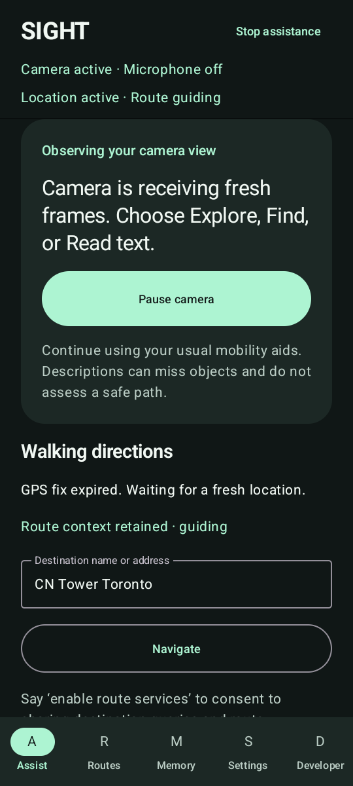
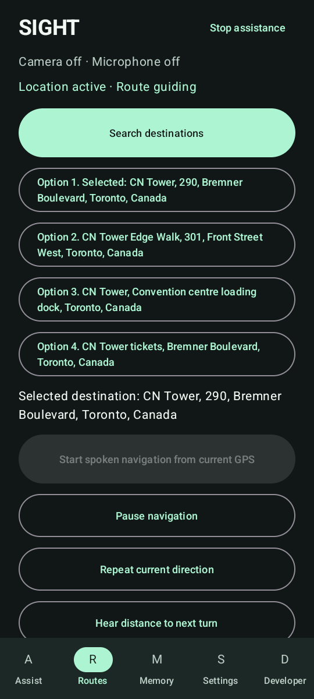
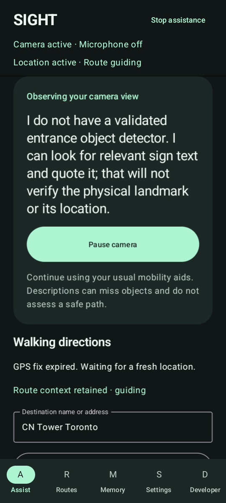

# SIGHT

SIGHT is an Android visual companion with provider-backed walking directions, on-device object finding, scene descriptions, text reading, and user-initiated offline voice commands. It is experimental assistive software, not an independent mobility aid. It does not decide when a road is safe to cross or whether a path is clear.

## What works now

- Search real destinations, select a numbered match, request a walking route, and receive route progress from fresh GPS fixes while SIGHT stays open. Route services are opt-in. Directions come from public map data; sidewalk access, crossings, entrances, and current conditions are not verified.
- Explore a live camera view, find supported detector categories, read captured text, ask bounded questions about recent image observations, and optionally save encrypted landmarks. Camera descriptions refer to left, center, and right in the image.
- Ask for walking awareness to hear a conservative, camera-relative description of selected detected traffic objects. It requires two-frame persistence, fresh evidence and category confidence thresholds; it cannot estimate object motion or crossing safety. Text search can look for door, entrance, elevator, or bus-stop wording in captured OCR, but does not visually identify or locate those objects.
- Start one voice command on demand. Android on-device recognition is preferred; bundled offline English recognition is available on supported configurations. There is no wake word or continuous background listening. Volume Up starts a command and Volume Down stops assistance while the app is open.
- Request an experimental Intel road-segmentation diagnostic. This separate LiteRT model outputs road, curb, and road-marking classes. Automatic road voice alerts are **off**: the balanced 40-image held-out set measured 17 TP, 1 FP, 3 FN, 19 TN and 0.025 false events/image, above the 0.02 limit. Strict road-pixel IoU was 0.6448. It has no independently validated curb output and markings do not mean crosswalks; see the [balanced road evaluation](evaluation/results/pedestrian-balanced/report.md).

The Android UI has Assist, Routes, Memory, Settings, and Developer areas. App backgrounding pauses camera, microphone, and GPS. See the [product engineering report](docs/product-engineering-report.md), [architecture](docs/product-architecture.md), and [walkthrough](docs/product-demo.md) for implementation status and evidence.

## Build and install

Requirements: JDK 21 and Android SDK platform 35 / build tools 35.0.0. Set `ANDROID_HOME` or create an untracked `local.properties` with `sdk.dir=C:/path/to/Android/Sdk`. The `build.ps1` entrypoint is for Windows PowerShell and invokes `gradlew.bat`.

```powershell
./scripts/build.ps1
adb install -r app/build/outputs/apk/debug/app-debug.apk
adb shell am start -n org.sight.app/.MainActivity
```

The build script fetches checksum-verified model assets and the offline voice model before running project checks and assembling the debug APK. For Linux/macOS, use the tested [CI workflow](.github/workflows/ci.yml), which runs the PowerShell asset fetch scripts and Gradle wrapper tasks. For detailed setup, reproducible evaluations, and emulator commands, see [evaluation/README.md](evaluation/README.md) and [docs/product-demo.md](docs/product-demo.md).

## Evidence and limits

The SIGHT 3 detector study reported AP50 0.6040 and operating precision 0.9491 / recall 0.3394 on a fixed 80-image held-out COCO subset. These are historical benchmark results, not full-dataset, phone, or assistive-use accuracy. The [current product-validation manifest](evaluation/results/product-validation/summary.json) passed: JVM 146, Python 14, Android app 15 tests each on API 30 and API 35, Meta MDK 8, and offline speech 2. Lint recorded zero errors and 18 warnings. The debug APK is 236,261,986 bytes, SHA256 `cf5d8ab8e95fa3e6788d98ac4cbb97b52aaff7b334bc9b631aebcc6ce528c242`. [API 35](evaluation/results/product-android35/instrumentation-suite.txt), [API 30](evaluation/results/product-android30/instrumentation-suite.txt), [Meta](evaluation/results/product-meta/instrumentation-suite.txt), [offline speech](evaluation/results/product-google-speech/instrumentation-suite.txt), and [Python](evaluation/results/product-python-tests.txt) raw results are available. CI passed for runtime commit `61c9069` ([run](https://github.com/youssef061204/SIGHT/actions/runs/43157490737)), evidence commit `50b83d2` ([run](https://github.com/youssef061204/SIGHT/actions/runs/43158217750)), and the release tag ([run](https://github.com/youssef061204/SIGHT/actions/runs/43158256740)).

No physical phone, actual glasses, microphone recognition, human TalkBack usability, blind-participant usability, battery endurance, or outdoor navigation study is claimed. Keep using ordinary mobility aids and established crossing practices. SIGHT can miss objects and cannot establish clearance or safe crossing.

## Project and publication

Public repository: [github.com/youssef061204/SIGHT](https://github.com/youssef061204/SIGHT). The [`public-preview` release](https://github.com/youssef061204/SIGHT/releases/tag/public-preview) includes the [debug APK](https://github.com/youssef061204/SIGHT/releases/download/public-preview/sight-android-debug.apk) and [demo video](docs/media/sight-demo.mp4). The APK download was verified at HTTP 200 with the expected size and SHA256. The 112.8-second video shows the real app and live public Photon/OSRM responses; GPS is simulated, the camera is virtual, commands are typed, and there is no audio or microphone capture. The [portfolio project page](https://youssefelsokkary.vercel.app/projects/sight) is also live. See the [media index](docs/media/README.md) for provenance and screenshots.

<p>
<a href="docs/media/assist-camera.png"></a>
<a href="docs/media/route-guidance.png"></a>
<a href="docs/media/entrance-text-search.png"></a>
</p>

## Preserved project history

SIGHT was upgraded in place. Historic reports and artifacts remain available: [SIGHT 3 engineering report](docs/engineering-report-v3.md), [SIGHT 3 architecture](docs/architecture-v3.md), [SIGHT 3 demonstration](docs/demo-v3.md), [SIGHT 2 engineering report](docs/engineering-report.md), and [detector evaluation](evaluation/results/v3-detection/report.md). These preserve their original names and metrics as historical evidence.
