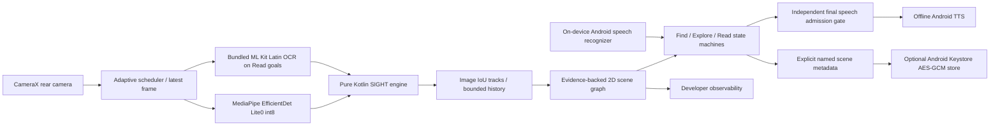

# Architecture

## Boundaries

`core` is a JVM library with no Android or model-vendor dependency. Its evidence, detections, normalized image boxes, text observations, track history, scene relations, task states and announcements are typed. `EngineTools` exposes structured tool results, evidence and errors over the same engine; unavailable location, depth and routing inputs cannot become successful observations.

`app` owns Android lifecycle/permission handling, CameraX capture, MediaPipe Tasks, ML Kit, the accessible Compose interface, offline speech and encrypted explicit memory. Main-thread engine calls serialize camera results, user commands, lifecycle and speech admission. Heavy capture conversion/inference runs on one dedicated executor. Android on-device voice support is queried rather than assumed.

`integrations/meta` is a separate optional Android library with its own pinned official SDK dependencies. It compiles independently and does not silently replace the phone source or imply a working wearable product. Raw Meta YUV transport still requires a validated pixel-format conversion before reuse in RGB perception.

`evaluation` executes actual desktop models, records raw outputs and calculates supported metrics. It also drives the production JVM core with explicitly identified repeat-image replay. Synthetic stability fixtures are not temporal camera ground truth.

## Perception and time

CameraX `KEEP_ONLY_LATEST` bounds its pending buffer. A single analyzer closes every `ImageProxy` in `finally`; there is no app frame queue. Detector admission defaults to 250 ms intervals, OCR to 1 second only during active Read goals; thermal/power constraints increase intervals. Critical thermal state suspends scheduled inference. This is a target cadence, not measured inference FPS.

Images are oriented according to CameraX rotation before inference. MediaPipe VIDEO mode runs synchronously; stale results are rejected by the core at receipt and again immediately before speech. The app's detector returns at most 20 results at score 0.50 or higher. Narration requires at least 0.65 and two persistent observations. Scores are uncalibrated model outputs, not correctness probabilities.

MediaPipe Tasks Vision 1.1.1 owns and recycles the bitmap supplied to its `MPImage`. The detector therefore creates its own bitmap copy and closes that image after inference. The camera's original remains valid for OCR and subsequent operations. Native tests assert this ownership contract across repeated detections. An OCR timeout does not invalidate successful object inference; one outstanding OCR task owns its copy until native completion, with a retry cooldown and no accumulating OCR queue.

All live freshness checks use monotonic milliseconds. When Camera2 declares `SENSOR_INFO_TIMESTAMP_SOURCE_REALTIME`, its exposure timestamp shares `elapsedRealtime` and is used as capture time. Otherwise evidence is explicitly marked `RECEIPT`; reliability is reduced because sensor-to-analyzer delay is unknown. It would be incorrect to report this fallback as measured camera-to-speech latency. Diagnostics retain the raw sensor timestamp and declared timing basis. Sensor-clock alignment requires physical validation.

Speech diagnostics record `ttsRequestAtMs` and `observationToTtsRequestMs`, measuring admission/submission rather than audible onset. Actual output latency, speaker routing and intelligibility need physical measurement. Only installed English voices that declare no network requirement are selected; selection failure leaves speech unavailable.

The model receives strictly increasing video timestamps, distinct from evidence time. Results older than 1.5 seconds, future evidence, duplicate/out-of-order results and pre-lifecycle results cannot update the live scene. A failed camera/model invalidates live availability. A bounded OCR-owned bitmap is released only when ML Kit completes, including after timeout.

## Scene and agent

Category-gated one-to-one greedy IoU matching hypothesizes short image identities. It stores at most 80 tracks and 12 history samples per track. Tracks become invisible after missed observations or age and expire after five seconds. A one-second association gap prevents long-delayed identity reuse. Fast camera motion, object crossings and occlusion can fragment or swap identities. There is no optical flow between detector frames and no claim of physical-world localization.

Relations describe only visible image geometry: left-of, above and overlapping image boxes. They do not mean physical adjacency, support surfaces, navigability or depth. A scene named 'entrance' is a user label for remembered evidence and does not establish a door detection or stable place recognition.

Find has search, verification, completion, unsupported, cancellation, resume and timeout states. Two fresh post-command observations of the same image track are required. Missing targets prompt an evidence request. A table/chair hint is offered only when that surface is actually observed. Absence of a detection never establishes physical absence. The independent speech validator checks evidence source, lifecycle, age and current grounding. There is no LLM able to bypass it.

Narration ranks stable novel objects by confidence, varies the maximum count with detail profile and suppresses repeated track/side announcements. A capacity-three pending speech deque has one active utterance. User requests interrupt ambient speech. Final admission checks occur before TTS submission and at actual utterance start. Ongoing live speech is stopped when its current grounded tracks disappear or change image side; a fresh-admitted OCR snapshot may finish as a captured-text reading. No continuous stereo movement cues are emitted.

## Storage and data transmission

Raw frames exist only transiently for preview and inference, never on disk by default. Scene tracks, OCR transcript, traces and timing samples are bounded in process memory. Explicit landmark saves contain a name, wall-clock save time, source, image-relative descriptions and optional OCR text, with no photos, biometric identity, GPS or visual descriptors. Android Keystore AES-GCM protects the saved payload; app backup is disabled. Current persistence retains at most 20 landmarks for 30 days. Wall-clock changes can affect retention and must be tested.

The 30-day limit filters recall on load and subsequent saves. Expired records may remain inside the encrypted preference payload until the next write or explicit deletion; there is no closed-app expiry timer or physical-storage erasure guarantee.

Baseline detection, OCR, task reasoning, memory and speech can operate without network connectivity. ML Kit can send SDK diagnostics to Google when connected; its terms state that images and recognized output stay on device. Onboarding and Settings disclose this SDK behavior, and airplane mode permits offline sessions. Optional routing has its own user consent/data boundary and never consumes camera images. Diagnostic JSON export uses Android's document picker; SIGHT does not automatically upload exported observations. The user chooses any later sharing destination. [ML Kit disclosure](https://developers.google.com/ml-kit/android-data-disclosure), [privacy terms](https://developers.google.com/ml-kit/terms).
